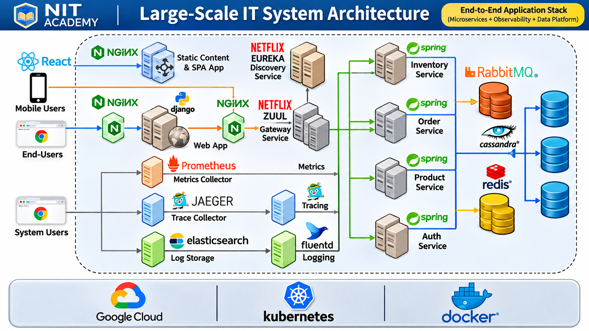

# 1.0 Introduction to an IT System

**NIT Academy | Software Architecture and Large-Scale Systems**

## 🎯 Learning Objectives

By the end of this introductory lesson, students should be able to:

- Describe the overall goal of implementing the software architecture of a large-scale system.
- Explain how a simple **three-tier architecture** can evolve into a more complete large-scale system.
- Identify why architectural challenges emerge as systems grow.
- Describe the role of modern architecture and open-source products in addressing those challenges.
- Compare two ways to study this course: observing demonstrations or building the system hands-on.
- Distinguish between learning architecture principles and implementing an architecture in practice.


## 1. Introduction: What Will We Build?


The purpose of this course is to learn how to **implement the software architecture of a large-scale system**.

By the end of the course, the goal is to have a **complete end-to-end system running on a machine**. Instead of studying each technology in isolation, students will follow the process of creating a working system and progressively improving its architecture.

We will begin with a relatively simple application architecture and explore how it can evolve into a more sophisticated system as new requirements and challenges arise.

### Conceptual learning journey

```text
Simple Application
       |
       v
Three-Tier Architecture
       |
       v
Identify Architectural Challenges
       |
       v
Explore Modern Architecture and Open-Source Solutions
       |
       v
Implement and Integrate Components
       |
       v
Complete End-to-End System
```

This is a **course progression**, not a claim that every large-scale system must use exactly these steps or components.

## 2. Understanding a Three-Tier Architecture

A common starting point for an application is a three-tier design:

1. **Presentation tier:** The interface used by the user.
2. **Application tier:** The component that processes requests and applies business logic.
3. **Data tier:** The component that stores and retrieves application data.

```text
                  USERS
                    |
                    v
        +-----------------------+
        | Presentation Tier     |
        | Web / User Interface  |
        +-----------------------+
                    |
                    v
        +-----------------------+
        | Application Tier      |
        | Business Logic / API  |
        +-----------------------+
                    |
                    v
        +-----------------------+
        | Data Tier             |
        | Database / Storage    |
        +-----------------------+
```

**Instructor clarification:** The three-tier explanation above is supplemental teaching context. The source lecture introduces a simple architecture but does not yet specify its components or technologies.

## 3. Why Does Architecture Need to Evolve?

As the course progresses, we will examine architectural challenges and how modern approaches and open-source products can help solve them.

Examples of challenges that students may encounter in a large-scale system include:

| Potential challenge | Question an architect might ask |
|---|---|
| Growth | What happens when more users access the application? |
| Reliability | What happens if one component becomes unavailable? |
| Performance | How can the application respond efficiently? |
| Maintainability | How can components be changed without disrupting the entire system? |
| Operations | How can the system be deployed, monitored, and maintained? |

**Note:** These are illustrative architectural questions for classroom discussion; the introductory lecture does not yet identify specific solutions.

## 4. Two Ways to Take This Course

The instructor describes two approaches to learning.

### Option 1 — Watch and Follow the Demonstrations

Students can listen to the explanations and observe the instructor as the system is created.

This approach helps students understand:

- How a large-scale system is architected.
- How individual parts of a system are implemented.
- How the overall creation process fits together.

**Best suited for:** Students who want an architectural overview or need to move through the course quickly.

### Option 2 — Build and Run the System Alongside the Instructor

Students can download the provided codebase, build it, and run it while following the demonstrations.

This approach offers:

- Firsthand experience of system creation.
- Opportunities to explore the code and environment independently.
- A better understanding of implementation details.
- Practical troubleshooting experience.

**Instructor recommendation:** Option 2 is the preferred approach when time and resources allow. Students who begin with Option 1 can return later to complete the hands-on work.

| Learning approach | Main activity | Primary benefit |
|---|---|---|
| Option 1 | Observe explanations and demonstrations | Understand the architecture and workflow |
| Option 2 | Download, build, run, and explore | Gain direct implementation experience |

## 5. Developer-to-Architect Learning Series

The lecture places this course within a broader **Developer-to-Architect** series.

### Course A — Software Architecture and Technology of Large-Scale Systems

Focuses on the **principles and concepts** that govern large-scale software systems.

Students should consult this course when they need a more detailed explanation of architectural principles or conceptual decisions.

### Course B — Implementing Software Architecture of a Large-Scale System

This is the practical course introduced in the lecture.

It focuses on:

- The hands-on system creation process.
- Lower-level insights into architectural challenges.
- Exploring open-source products.
- Implementing and integrating technologies to address challenges.

**Key distinction:** The first course emphasizes **why architecture works a certain way**; the second emphasizes **how to build and implement it**.

## 6. Suggested Classroom Activity

### Activity A — Draw the Starting Architecture

1. Draw three boxes labeled **Presentation**, **Application**, and **Data**.
2. Connect them with arrows showing a user request moving through the system.
3. Explain what each tier is responsible for.
4. Identify one question you would ask before making the system larger.

### Activity B — Choose Your Learning Path

Complete the following worksheet:

| Question | Student response |
|---|---|
| Will I watch demonstrations or build along? | |
| Do I have a machine or VM for practice? | |
| Have I obtained the course codebase? | |
| What architectural topic do I want to understand better? | |
| What do I want to have running at the end? | |

**Preparation reminder:** The transcript mentions downloading a codebase but does not provide a repository link, installation commands, or hardware requirements. Those details must be supplied in a later lesson.

## 7. Common Beginner Misunderstandings

- **“Large-scale architecture is just a list of tools.”** Architecture is also about how components are organized and how they interact.
- **“Watching a demonstration is the same as building.”** Observing helps conceptual understanding, while hands-on work adds practical experience.
- **“A three-tier application is already a complete large-scale system.”** It is a useful starting model; additional requirements may call for architectural changes.
- **“I must know every technology before starting.”** This course is designed to introduce implementation decisions progressively.

## 🧪 Knowledge Check

1. What is the main goal of this course?
2. What should students have running by the end of the course?
3. What is meant by evolving a simple architecture into a large-scale system?
4. What are the two learning approaches described by the instructor?
5. Why is building the system alongside the instructor recommended?
6. What is the difference between the conceptual and practical courses in the Developer-to-Architect series?
7. Why might an architect consider open-source products when addressing system challenges?

## 📌 Quick Revision

| Topic | Remember |
|---|---|
| Course objective | Implement a complete end-to-end system |
| Starting point | A simple application architecture |
| Progression | Examine challenges and evolve the architecture |
| Tools | Modern architecture and open-source products |
| Option 1 | Observe instructor demonstrations |
| Option 2 | Download, build, run, and explore the system |
| Conceptual course | Architecture principles and concepts |
| Practical course | Hands-on implementation and integration |

## 📖 Key Takeaways

- The course focuses on the **practical implementation** of software architecture.
- Students will progress from a simple architecture toward a complete system.
- Architectural challenges provide opportunities to learn why different approaches and technologies are useful.
- **Hands-on participation** is the recommended way to gain deeper experience.
- Conceptual knowledge and implementation skills complement each other.

## ⭐ Golden Rule

> **To understand a large-scale IT system, learn both how its components fit together and how to build, run, and improve them.**

---

**Next lesson:** The instructor will explain the specific topics and technologies covered during the system implementation journey.
