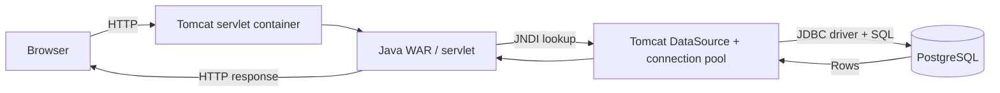

# NIT Academy — Step-by-Step DevOps Student Lab

**Project:** From personal GitHub repository to Jenkins, Maven, Docker, Tomcat, PostgreSQL, JDBC and JNDI.  
**Audience:** Linux + Git + basic Jenkins students.  
**Deliverable:** Working registration portal, one per student.

## 1. Learning goals

By the end, you will:

1. Fork the NIT Academy starter repository into your personal GitHub account.
2. Change Java/HTML code, commit and push.
3. Configure a Jenkins Pipeline **from SCM** that polls for GitHub changes.
4. Compile and package a Java Servlet application with Maven into `studentapp.war`.
5. Explain a servlet container and a Docker container, and build a custom Tomcat image.
6. Start Tomcat and PostgreSQL services using Docker Compose.
7. Explain JDBC, JNDI and Tomcat-managed connection pooling.
8. Query a real PostgreSQL table through the browser.
9. Make another Git commit and watch the automated redeployment.
10. Diagnose failures with Jenkins, Docker, curl and PostgreSQL commands.

## 2. First: why middleware, Tomcat and Docker?

- **Browser:** sends HTTP requests; it does not execute server-side Java code or SQL.
- **Tomcat:** HTTP connector and *servlet container*; hosts Java web apps and dispatches requests to servlets. It is often called part of the **middleware / application tier** because it sits between clients and backend resources. *Middleware is a functional role*, not a product category that all Tomcat installations must be called.
- **Java Servlet / WAR:** our application code receives a request, validates input, and runs business logic.
- **JDBC:** standard Java API for database access.
- **JNDI:** naming/lookup mechanism to find resources configured outside the application code.
- **DataSource / pool:** Tomcat-managed reusable JDBC connections.
- **PostgreSQL:** database engine and persistent records.
- **Docker:** OS-level container platform; packages Tomcat plus our app, driver, and configuration so the same image runs consistently. **Tomcat can run without Docker; Docker can run software other than Tomcat.**



## 3. Understand the pre-existing VM

The instructor may already be running Apache HTTPD on 80, Jenkins on 8080 and a **non-Docker** Tomcat under `/opt/tomcat` using another port. **Do not stop or remove those existing services.** This project uses separate Docker container(s), and each student's app gets a **distinct host port**.

Check the host safely:

```bash
hostname -I
java -version
mvn -version
git --version
docker --version
docker compose version
ss -tulpn | grep -E ':80|:8080|:1808'
```

| Student | STUDENT_ID | APP_PORT | URL path |
|---|---|---|---|
| Student 1 | `student01` | `18081` | `/studentapp/students` |
| Student 2 | `student02` | `18082` | `/studentapp/students` |
| Student 3 | `student03` | `18083` | `/studentapp/students` |

These are **examples** and must be assigned centrally. Docker maps `HOST:CONTAINER`, e.g. `18081:8080`. **Inside each isolated Tomcat container, port 8080 may be reused**, even when host port 8080 already belongs to Jenkins. PostgreSQL uses 5432 **inside its Docker network**, and does not publish a host port. This is why PostgreSQL services for multiple students do not collide.

## 4. Fork and clone the starter repository

**Instructor first publishes this ZIP as a GitHub repository** in the NIT Academy organization and communicates the exact GitHub repository URL.

1. Log into your personal GitHub account.
2. Open the instructor's published NIT Academy repository.
3. Click **Fork** (or create a new repository and import/copy the starter code if forks are disabled).
4. Verify the new repository exists under your own username.
5. Clone your personal repository:

```bash
git clone https://github.com/YOUR-USERNAME/nit-devops-student-portal.git
cd nit-devops-student-portal
git remote -v
ls -la
```

Replace `YOUR-USERNAME` with your actual username. A URL used in this example is a placeholder, not a verified live NIT Academy repository.

## 5. Locate and understand the code

```text
nit-devops-student-portal/
├── Jenkinsfile                        # Jenkins pipeline, including SCM polling
├── pom.xml                            # Maven configuration (WAR build)
├── Dockerfile                         # Custom Tomcat image recipe
├── compose.yaml                       # Tomcat + PostgreSQL containers
├── db/init.sql                        # Creates table on FIRST database initialization
├── docker/tomcat-context.xml          # Tomcat JNDI DataSource and pool
├── src/main/java/academy/nit/portal/
│   └── StudentServlet.java            # GET/POST + JDBC examples
├── src/main/webapp/
│   ├── index.html                      # Landing page
│   └── WEB-INF/web.xml                 # JNDI resource declaration
└── docs/
    ├── STUDENT_LAB.md
    └── INSTRUCTOR_GUIDE.md
```

Open `StudentServlet.java` in VS Code. Observe:

```java
DataSource ds = (DataSource) new InitialContext()
    .lookup("java:comp/env/jdbc/StudentDB");
```

This is **JNDI resource lookup**, not an SQL query. Later:

```java
try (Connection c = dataSource.getConnection();
     PreparedStatement ps = c.prepareStatement(
          "INSERT INTO students (full_name, course) VALUES (?, ?)")) {
    ps.setString(1, name);
    ps.setString(2, course);
    ps.executeUpdate();
}
```

`getConnection()` borrows a JDBC connection. A `PreparedStatement` parameterizes SQL (instead of concatenating input). `try-with-resources` closes the handle and ordinarily **returns the physical connection to the pool**.

## 6. Build a WAR manually first (before Jenkins)

```bash
mvn -B -ntp clean verify
ls -lh target/studentapp.war
jar tf target/studentapp.war | head -30
```

Expected artifact: `target/studentapp.war`. `WAR` means **Web Application Archive**; it can be deployed to compatible Tomcat installations. This project targets **Tomcat 10.1 (Jakarta Servlet 6.0, Java 17)** and is **not** written for legacy Tomcat 9 `javax.servlet` APIs.

The PostgreSQL driver must be available to **Tomcat's connection pool classloader**, not just the web application. Create an unpacked JDBC driver directory:

```bash
mvn -B -ntp dependency:copy-dependencies \
  -DincludeArtifactIds=postgresql -DoutputDirectory=target/jdbc
ls -lh target/jdbc/postgresql-*.jar
```

## 7. Instructor: prepare Jenkins one time

The Jenkins agent running this job needs Java 17, Maven, Git, Docker CLI, Docker Compose, and curl installed. It must be an **isolated and trusted training agent** with access to the host's Docker engine. The required Jenkins credentials-binding capability must be available.

In **Manage Jenkins → Credentials**, instructor creates a **Secret text** credential:

- ID: `nit-lab-postgres-password`
- Secret: a lab-only, random database password; **not** a production password

The instructor must control the Jenkinsfiles that can be run with Docker privileges. **Giving untrusted student-editable pipelines Docker access can allow host takeover**. On a shared VM, let the instructor review changes or run an approved/pinned pipeline in a separate trusted deployment job. For a classroom demonstration, these sample pipelines assume trusted, supervised students.

## 8. Connect your personal GitHub repository to Jenkins

1. Open Jenkins, for example `http://VM-IP:8080/` (verify the actual Jenkins port).
2. Click **New Item** → enter a unique name such as `student01-portal` → **Pipeline**.
3. In **Pipeline → Definition**, choose **Pipeline script from SCM**.
4. **SCM:** Git.
5. **Repository URL:** your own GitHub repository HTTPS URL.
6. **Credentials:** select a GitHub credential only if your repo is private. Public repos normally need none.
7. **Branch Specifier:** `*/main` (or your actual default branch).
8. **Script Path:** `Jenkinsfile`.
9. Save.
10. Click **Build Now** to initialize the job. If parameters were just introduced, the first build may populate job parameters; subsequent builds should use **Build with Parameters**.
11. Set your assigned **STUDENT_ID** and **APP_PORT**. **Never let all students deploy with the defaults.**

The Jenkinsfile contains:

```groovy
triggers { pollSCM('H/2 * * * *') }
```

This tells Jenkins to check Git SCM approximately every two minutes, with a hashed offset. A changed commit triggers a build; merely running a periodic check does not automatically redeploy unchanged source. Jenkins must be able to reach the GitHub URL. For production GitHub integrations, webhooks are often preferred.

## 9. Jenkins pipeline: what each stage teaches

| Stage | Student learning |
|---|---|
| Validate | Avoid unsafe / conflicting student IDs and ports |
| Checkout | Obtain source from GitHub |
| Maven build and verification | Compile Java source and package `studentapp.war` |
| Archive WAR | Preserve a versioned build artifact |
| Deploy Docker Compose | Build custom Tomcat image, start database and app |
| Smoke test | Verify Tomcat can use JDBC to query PostgreSQL |

On a **single VM**, the Jenkins agent uses the Docker CLI to manage containers using the host Docker daemon. In a real multi-node CI/CD architecture, build and deploy jobs should be separated, with controlled access to the destination host.

## 10. Docker image: why not just `docker run tomcat`?

Run the stock image as a controlled experiment **only if Docker access is authorized**:

```bash
docker run --rm -d --name tomcat-demo -p 19090:8080 tomcat:10.1-jdk17-temurin
curl -I http://127.0.0.1:19090/
docker rm -f tomcat-demo
```

The stock image starts the **Tomcat server**, but it **does not include your student application WAR, PostgreSQL driver or JNDI configuration**. An HTTP 404 at the root URL is normal in the official image when no root app has been deployed; this does **not** mean Tomcat failed to start.

Our `Dockerfile` includes:

```dockerfile
FROM tomcat:10.1-jdk17-temurin
COPY target/jdbc/postgresql-*.jar /usr/local/tomcat/lib/
COPY docker/tomcat-context.xml /usr/local/tomcat/conf/Catalina/localhost/studentapp.xml
COPY target/studentapp.war /usr/local/tomcat/webapps/studentapp.war
RUN printf '%s\\n' 'org.apache.tomcat.util.digester.PROPERTY_SOURCE=org.apache.tomcat.util.digester.EnvironmentPropertySource' >> /usr/local/tomcat/conf/catalina.properties
EXPOSE 8080
```

`FROM` selects a reusable base image. `COPY` packages your app and database access configuration. `EXPOSE` documents the container's intended listening port; it **does not publish a host port**. Docker Compose handles host-to-container port mapping.

## 11. PostgreSQL database setup with Docker Compose

Read `compose.yaml`:

- `db` starts PostgreSQL 16 (container port **5432**, not published on the host).
- `app` builds the custom Tomcat image (container port **8080**).
- `depends_on` waits until PostgreSQL passes a readiness check.
- `pgdata` is a named Docker volume preserving database contents when the container is replaced.
- Docker Compose creates a separate virtual network and volume **for each unique Compose project name**.
- `DB_PASSWORD` comes from Jenkins credentials, not the Git repository.

### What actually creates the table?

At **first database initialization**, PostgreSQL executes `db/init.sql`:

```sql
CREATE TABLE IF NOT EXISTS students (
  id INTEGER GENERATED ALWAYS AS IDENTITY PRIMARY KEY,
  full_name VARCHAR(100) NOT NULL,
  course VARCHAR(100) NOT NULL,
  created_at TIMESTAMPTZ NOT NULL DEFAULT NOW()
);
```

**Important:** changes to `init.sql` are **not rerun automatically** on an already-initialized PostgreSQL volume. Real systems use migrations; this is an introductory lab.

## 12. JNDI + JDBC + connection pool

1. The servlet looks up `java:comp/env/jdbc/StudentDB` using JNDI.
2. Tomcat finds the `Resource` declared in `docker/tomcat-context.xml`.
3. The Resource specifies `org.postgresql.Driver` and the PostgreSQL URL `jdbc:postgresql://db:5432/studentdb`.
4. Tomcat reads `DB_PASSWORD` from the container environment, via its `EnvironmentPropertySource` feature.
5. Tomcat's default DBCP2 DataSource manages reusable JDBC connections (maximum **10** in this example).
6. `getConnection()` borrows a connection; SQL executes through a `PreparedStatement`.
7. Closing the connection handle returns it to the pool.

```xml
<Resource name="jdbc/StudentDB" auth="Container"
          type="javax.sql.DataSource"
          driverClassName="org.postgresql.Driver"
          url="jdbc:postgresql://db:5432/studentdb"
          username="studentapp" password="${DB_PASSWORD}"
          initialSize="2" maxTotal="10" maxIdle="5"
          maxWaitMillis="10000" />
```

**Why is the URL host `db` rather than `localhost`?** `db` is the PostgreSQL **Docker Compose service name** and is resolved on the project's internal Docker network. Inside the Tomcat container, `localhost` refers to the **Tomcat container itself**, not the PostgreSQL container or the VM.

**Why `javax.sql.DataSource` if Tomcat 10 uses `jakarta.servlet`?** JDBC's `javax.sql.DataSource` remains a standard Java SE API. Servlet APIs migrated to `jakarta.servlet`, but JDBC did not.

## 13. Deploy and test

After the Jenkins build succeeds, open **your assigned** URL:

```text
http://VM-IP:18081/studentapp/students
```

Register yourself and a course. Refresh the browser. You should see your inserted record.

From the VM, check:

```bash
curl -i http://127.0.0.1:18081/studentapp/health
curl -i http://127.0.0.1:18081/studentapp/students
```

Expected `/health` response contains:

```text
OK - Tomcat + JDBC + PostgreSQL
```

View containers (substitute your student ID):

```bash
docker compose -p nit-student01 -f compose.yaml ps
docker compose -p nit-student01 -f compose.yaml logs --tail=80 app
docker compose -p nit-student01 -f compose.yaml logs --tail=80 db
```

Inspect records **inside your own PostgreSQL container**:

```bash
docker compose -p nit-student01 -f compose.yaml exec db \
  psql -U studentapp -d studentdb \
  -c 'SELECT id, full_name, course FROM students ORDER BY id;'
```

## 14. Change code and demonstrate automatic CI/CD

Edit `src/main/webapp/index.html` and change the page heading to include your own name or student ID. Then:

```bash
git status
git add src/main/webapp/index.html
git commit -m "Personalize NIT student portal"
git push origin main
```

Wait for Jenkins SCM polling to detect the change, then open **Build History** and observe new Maven, Docker deployment and health-check stages. Finally refresh:

```text
http://VM-IP:18081/studentapp/
```

**Expected:** The heading changed without manually copying a WAR into `/opt/tomcat/webapps`. The CI/CD pipeline built a new WAR and image, replaced the app container and preserved the PostgreSQL volume.

## 15. Optional local/manual Docker deployment (without Jenkins)

Only do this if the instructor has approved your unique port and you have Docker permission:

```bash
mvn -B -ntp clean verify
mvn -B -ntp dependency:copy-dependencies \
  -DincludeArtifactIds=postgresql -DoutputDirectory=target/jdbc
export STUDENT_ID=student01
export APP_PORT=18081
read -rs -p 'Lab PostgreSQL password: ' DB_PASSWORD; echo
export DB_PASSWORD
docker compose -p "nit-${STUDENT_ID}" up -d --build
curl http://127.0.0.1:${APP_PORT}/studentapp/health
unset DB_PASSWORD
```

Use a lab-only password and never commit `.env` or database secrets. The above environment variable is for classroom use; in production adopt managed secrets.

## 16. Troubleshooting guide

| Symptom | Likely cause | What to check |
|---|---|---|
| `Address already in use` | Another process owns the host port | `ss -tulpn`, unique `APP_PORT` |
| `docker: permission denied` | Jenkins agent lacks Docker permission | Instructor checks agent / Docker access |
| `docker compose: command not found` | Compose plugin absent | `docker compose version` |
| `mvn: command not found` | Maven not installed/on Jenkins PATH | `mvn -version` |
| `package javax.servlet does not exist` | Wrong servlet API for Tomcat 10 | Use `jakarta.servlet` in Java source |
| HTTP 404 `/` | App deployed at a context path | Visit `/studentapp/` or `/studentapp/students` |
| HTTP 503 on `/health` | DB connectivity / query failure | `docker compose ... logs app db` |
| JNDI `NameNotFoundException` | Resource missing/misnamed | `web.xml`, Tomcat `studentapp.xml` |
| `ClassNotFoundException: org.postgresql.Driver` | JDBC JAR missing from Tomcat lib | Dockerfile and `target/jdbc/` |
| `Connection refused` to PostgreSQL | DB not ready / wrong hostname | Use `db:5432` inside Docker network |
| Change to `init.sql` has no effect | Database volume already initialized | Apply SQL explicitly; do NOT delete a volume casually |
| Jenkins never polls | SCM job, branch, Git URL, or trigger problem | Jenkins job config, Git logs, SCM polling log |

## 17. Safe cleanup (instructor-approved)

**Stop only your project's app and DB containers; preserve records:**

```bash
docker compose -p nit-student01 -f compose.yaml down
```

**DANGER: Permanent data deletion:** The additional `-v` flag removes the student's named PostgreSQL volume and all stored records. Use it **only if specifically approved and data loss is intended**:

```bash
# DANGER - DO NOT RUN AS ROUTINE CLEANUP
# docker compose -p nit-student01 -f compose.yaml down -v
```

Do **not** use global `docker system prune --volumes` on a shared classroom VM.

## 18. Student exercises

1. Fork the NIT starter repo, clone your fork and show `git remote -v`.
2. Explain why the Tomcat container listens on **8080** while your browser reaches **18081**.
3. Identify the Java statement performing a JNDI lookup.
4. Identify where JDBC `PreparedStatement` is used and explain why `?` parameters matter.
5. Register two students. Query the table using `psql` to verify that rows are real database records.
6. Change the landing-page heading, commit and push. Show the new Jenkins build number.
7. Restart the app container and verify that student records persist in PostgreSQL.
8. Explain why raw `docker run tomcat` is not enough to deploy your customized application.
9. Change the connection pool setting `maxTotal` in `docker/tomcat-context.xml`, commit and redeploy. Explain the consequence of too few or too many connections.
10. Capture the Jenkins stage log, browser screenshot, and `psql` query output as evidence.

## 19. Quiz — short answers

1. What is a WAR file?
2. What does a servlet container do?
3. Why is Tomcat sometimes part of middleware?
4. What does Docker isolate that a WAR does not?
5. What causes Jenkins polling to trigger a new build?
6. How do JDBC and JNDI differ?
7. What is a DataSource and why pool connections?
8. Why should each student use a unique Compose project name and web port?
9. What happens to database rows when the Tomcat app container is replaced?
10. Where are application secrets stored for this introductory Jenkins setup?

**Instructor review:** Student submits GitHub repo URL, Jenkins job name, assigned port, application URL, screenshot of registration page, successful Jenkins build, and `psql` output.
