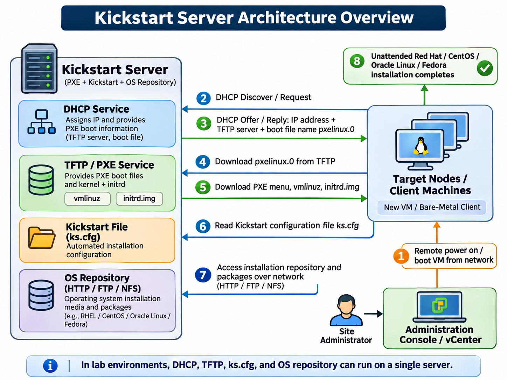

# Automated Linux Installation Using Kickstart

In the world of Data Centers (DC) we have the following:
1. On-premises (On-prem) bare-metal servers. When we say `bare-metal = NO Operating System`. This means we have to take a brand new machine (server like Dell R620) and install an operating system like Linux or Windows Server. `on-prem` servers allow us to build Virtual machines that utilize the resources (CPU, RAM and Storage) of the bare-metal. Typically `25 Servers` are `provisioned and configured` to provide services like: `dhcp, dns, load balancer, email server, web servers, NGINX etc..`
2. Virtual Machiens (VM) are build on top of bare-metal servers.

## Learning Objectives

By the end of this lesson, you will be able to:

- Explain what Kickstart is and why administrators use it.
- Compare manual and automated Linux installations.
- Describe the role of Anaconda and a Kickstart configuration file.
- Identify the network services commonly used for PXE-based Kickstart installations.
- List the benefits of Kickstart, including post-installation automation.

## 1. What Is Kickstart?

**Kickstart** is an automated installation method used primarily with **Red Hat Enterprise Linux (RHEL)** and related Linux distributions, including Fedora, CentOS-derived systems, Rocky Linux, AlmaLinux, and Oracle Linux.

Instead of answering installation questions manually on every computer, a system administrator creates a **Kickstart configuration file** that tells the installer how to install and configure the operating system.

The file can specify:

- Language, keyboard layout, time zone, and date/time settings
- Storage devices, disk partitioning, and filesystems
- Networking and hostnames
- User accounts and authentication settings
- Package groups and individual packages
- Security settings
- Scripts to run before or after installation

> **Key idea:** Kickstart enables repeatable, largely unattended installations of Linux operating systems.

## 2. Why Do We Need Kickstart?

Imagine that you work as a Linux system administrator for an organization. `Your daily responsibilities include provisioning new Linux servers.`

For a **manual installation** on a virtual machine, you might need to:

1. Sign in to a virtualization management platform, such as VMware vCenter.
2. Create or deploy a VM and allocate CPU, RAM, disk space, and network interfaces.
3. Attach an operating system installation ISO or use another boot source.
4. Boot the new machine into the Linux installer.
5. Manually answer questions about locale, time zone, partitions, packages, users, and security.
6. Complete installation and perform post-installation configuration.

If you must build **10 or 100 servers**, repeating these tasks manually takes time and creates opportunities for inconsistent configurations.

`With Kickstart, the installer reads your prewritten answers from a configuration file. You can therefore automate OS installations across many servers and reduce repetitive manual work.`

**Important distinction:** Kickstart automates the **operating system installation**. Creating a virtual machine, configuring its virtual hardware, or provisioning a physical server may require a separate tool or workflow (for example, vCenter templates, Terraform, or a provisioning platform).

## 3. How Kickstart Works with Anaconda

**Anaconda** is the installer used by RHEL and several related Linux distributions. It needs installation instructions, such as:

- How to partition the disk
- How to configure the network
- Which packages to install
- Which users and security settings to create

A **Kickstart file**, usually named `ks.cfg`, provides these instructions automatically.

A Kickstart installation can boot from local installation media or over the network. **PXE is a common way to boot clients over the network, but PXE is not required to use Kickstart.**

## 4. Typical Network-Based Kickstart Architecture

For a PXE-based automated installation environment, you commonly use the following components:

| Component | Purpose |
|---|---|
| **Kickstart file (`ks.cfg`)** | Contains automated installation instructions. |
| **DHCP server** | Provides client network settings and, in traditional PXE setups, boot information. |
| **TFTP server** | Often serves network bootloader files in traditional PXE environments. Other boot methods, including UEFI HTTP Boot, can use HTTP instead. |
| **HTTP, HTTPS, FTP, or NFS server** | Can serve installation resources, depending on distribution and installer support. HTTP/HTTPS is common for modern deployments. |
| **Installation repository or OS image** | Supplies the packages and files needed to install Linux. |
| **Anaconda installer** | Reads the Kickstart instructions and performs the installation. |

### Simplified workflow

```text
            +------------------------+
            |   DHCP / Boot Service  |
            +-----------+------------+
                        |
                        v
+------------------+   PXE boot    +------------------+
| New Linux Client | ------------> | Network Boot     |
| (Physical or VM) |               | Files / Installer|
+---------+--------+               +------------------+
          |
          | Retrieves installation instructions
          v
+--------------------------+
| Kickstart File (ks.cfg)  |
+------------+-------------+
             |
             v
+--------------------------+
| OS Installation Source   |
| (e.g., HTTP repository)  |
+------------+-------------+
             |
             v
+--------------------------+
| Anaconda Installs Linux  |
| and Runs Optional Scripts|
+--------------------------+
```


> **Note:** The diagram illustrates the roles involved, not every packet exchange or bootloader step. Services may run on one server or across multiple servers.

## 5. Benefits of Kickstart

1. **Automated installations:** Install Linux with minimal interactive input.
2. **Scalability:** Provision multiple servers using the same or customized Kickstart configurations.
3. **Consistency:** Apply standardized settings across servers.
4. **Time savings:** Reduce repetitive installation tasks.
5. **Support for multiple distributions:** Maintain appropriate Kickstart files and repositories for compatible RHEL-family distributions and versions.
6. **Post-installation automation:** Run scripts to configure the system after packages are installed.

### Example: Post-Installation Tasks

A Kickstart file can include a `%post` section to perform tasks such as:

- Creating additional users
- Installing or configuring software
- Enabling services
- Applying baseline settings
- Executing an organization-specific setup script

Example (illustrative):

```kickstart
%post --log=/root/ks-post.log
useradd trainee1
useradd trainee2
%end
```

This example creates two users after installation. A production Kickstart file also needs the necessary installation directives, and user authentication should be configured securely.

## 6. Kickstart and Similar Tools in Other Unix Systems

| Operating system | Automated installation tool or method |
|---|---|
| RHEL and compatible Linux distributions | Kickstart |
| Oracle Solaris (historically) | JumpStart; modern Oracle Solaris uses Automated Installer (AI) |
| HP-UX | Ignite-UX |

## 7. Quick Review

**Q1. What is Kickstart?**  
An automated installation method that uses a configuration file to provide Linux installer settings.

**Q2. Does Kickstart require PXE?**  
No. PXE is commonly used for network boot, but Kickstart also works with other ways of starting the installer.

**Q3. Which installer reads Kickstart files on RHEL?**  
Anaconda.

**Q4. What is the common Kickstart file name?**  
`ks.cfg`.

**Q5. Can Kickstart run scripts after installation?**  
Yes, through the `%post` section.

## 8. Lesson Summary

Kickstart simplifies Linux server deployment by automating the operating system installation process. Administrators define their installation requirements once in a configuration file, then reuse that file to install multiple systems. Network-based installations often combine Kickstart with DHCP, network boot services, and an OS installation repository.

**Next lesson:** Kickstart architecture and a step-by-step PXE/Kickstart lab.
